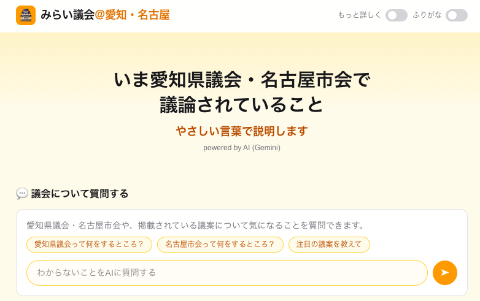
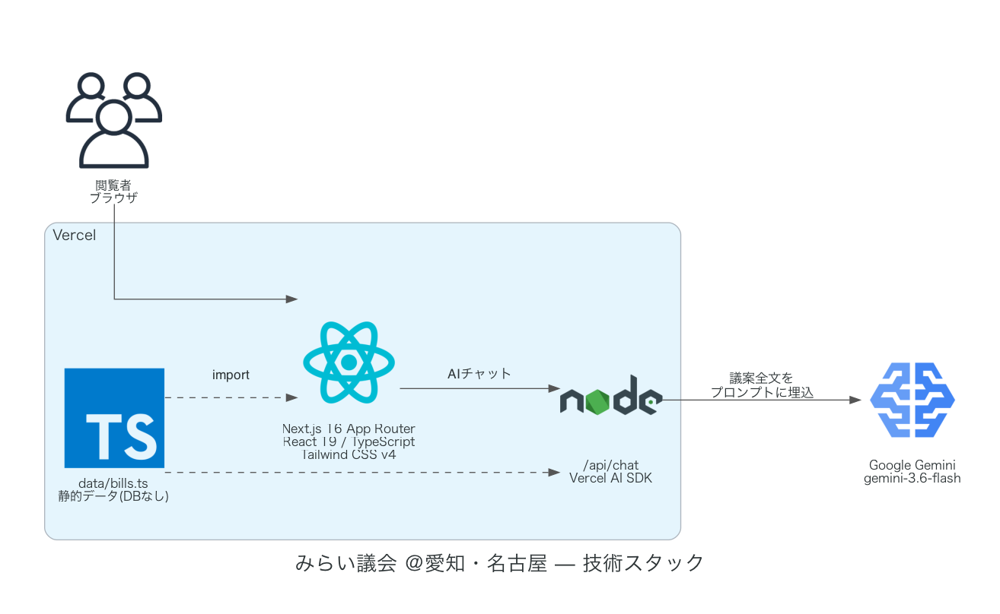

# みらい議会＠愛知・名古屋

愛知県議会・名古屋市会で審議された議案を、専門用語なしでわかりやすく伝える個人制作のサイトです。
政党チームみらいが運営しているものではない、非公式のサイトです。

| | URL |
| :--- | :--- |
| 公開サイト | https://mirai-gikai-nagoya.vercel.app/ |
| 管理画面(要ログイン) | https://mirai-gikai-nagoya.vercel.app/admin |

## 特徴

- **議案を10件掲載**: 愛知県議会・名古屋市会それぞれ5件。会議録検索で実際に個別審査が確認できた
  議案(予算案・新設条例・修正可決案など)を選定
- **かんたん解説 / くわしい解説**: ヘッダーのスイッチで表示を切り替え
- **ふりがな表示**: ヘッダーのスイッチでON/OFF。漢字部分だけにルビを振る(送り仮名には振らない)
- **みらい議会を参考にした詳細セクション**: 🎯この法律のポイント / ✏️この法律が必要な理由 /
  👀意見が分かれるところ / 🙋影響を受ける人
- **AIチャット**: Gemini(`gemini-3.6-flash`)による質問応答。トップページは全議案を横断した一般
  質問、議案詳細ページはその議案に絞った質問に対応
- **サムネイル**: 管理画面でアップロードした画像を表示。無い議案は自作イラスト、またはキーワード連動の関連写真
- **議案一覧**: 両議会の直近1年の議案(約450件)を、定例会ごとに一覧・絞り込み表示
- **管理画面(`/admin`)**:
  - 議案管理: 一覧・議会での絞り込み・並べ替え、公開/下書きの切り替え、レビュー完了、複製・削除、
    解説が未入力の「件名のみ」の議案の絞り込み
  - 議案の編集: 基本情報・解説・4つのセクション(ポイント等)の入力、セクションごとのAI生成、
    サムネイル画像のアップロード、ふりがなの語ごとの確認・修正
  - 議案一覧から作成: 取得済みの議案一覧から1件ずつ作成、またはチェックしたものを件名のみでまとめて登録
  - CSVインポート: CSV で議案をまとめて登録・更新(取り込み前に確認画面あり)
  - 管理者: 管理者の追加・パスワード変更・削除

## 使っているデータ

データはDBを持たず、静的ファイルとして管理しています。

- **議案一覧(直近1年・約450件)**: `data/agendas.json`。`npm run ingest:agendas` で生成します。
  - 名古屋市会は、市の公式サイトの議案一覧(市長提出案件・議員提出議案)を自動取得しています。
  - 愛知県議会は、県の公式サイトがスクリプトからのアクセスにボット判定を返すため自動取得していません。
    ブラウザで開いた議案表を `data/raw/aichi/*.tsv` に保存したスナップショットを読み込んでいます。
- **注目議案の解説**: DB(Neon / PostgreSQL)に置き、管理画面で作成・編集しています。DB を設定していない
  環境では、`data/bills.ts` の静的データ(10件)を表示します。
- **会議録**: 両議会の会議録検索システムが robots.txt で自動取得を禁止しているため、取得・掲載は
  していません。各ページから会議録検索へリンクしています。

> 議案一覧は取得した時点のスナップショットで、自動では更新されません。最新の審議状況は各議会の
> 公式サイトを確認してください。

| 議会 | 議案一覧 | 会議録検索 |
|---|---|---|
| 名古屋市会 | [市会の議案一覧](https://www.city.nagoya.jp/shikai/shingi/1030858/1030859/1046530.html) | [kaigiroku.net](https://ssp.kaigiroku.net/tenant/nagoya/SpTop.html) |
| 愛知県議会 | [議案・結果概要一覧](https://www.pref.aichi.jp/site/gikai/kekka-gaiyo.html) | [pref.aichi.dbsr.jp](https://www.pref.aichi.dbsr.jp/) |

議案一覧の件名を会議録検索にそのままキーワードとして検索し、実際にヒットする(≒個別に審査・
議決された)議案を選んでいます。予算の詳細な内訳や条例の細かい運用ルールなど公式資料でしか
確認できない部分は断定を避け、出典を見るよう案内する書き方にしています。

## アーキテクチャ

## 今後の展望: 最新議案の自動取得

現在は議案を手作業で追加していますが、以下の流れで自動化することを考えています。

1. **議案一覧の取得**: 各議会の議案一覧ページ(上表)をスクレイピングし、議案番号・議案名・
   付託委員会・議決結果を取り出す。両議会ともAPIは提供されておらず、議案ごとの個別ページも
   無いため、定例会ごとの一覧表(HTML)を解析することになる
2. **会議録との突き合わせ**: 取得した議案名をそのままキーワードとして会議録検索
   (kaigiroku.net / pref.aichi.dbsr.jp)にかけ、発言記録を取得する
3. **掲載対象の絞り込み**: 検索がヒットしなかった議案は落とす。軽微な条例の一部改正案などは
   一括上程・一括採決されて個別の発言記録が残らず、解説を書く材料が無いため
4. **解説文の生成**: 集めた発言記録をもとに、`summaryEasy` / `summaryDetailed` や詳細セクション
   をLLMで生成する
5. **ふりがなの再生成**: `npm run generate:furigana` を実行し、生成された解説文にルビを振る
6. **反映**: 生成結果を `data/bills.ts` に追記してコミット・デプロイする(GitHub Actionsの
   定期実行でPRを作る形を想定)

### 課題

- **生成内容の正確性**: 議案の解説は誤りが実害につながりやすく、LLMの生成結果をそのまま無検査で
  公開するのは避けたい。人によるレビューを挟む前提(自動PR → 目視確認 → マージ)にする必要がある
- **スクレイピングの安定性**: 公式サイトのHTML構造やURLは改編されることがあり、追従が必要
- **相手サイトへの負荷**: 定例会は年に数回しか開かれないため、実行頻度は日次以下で十分。
  アクセス間隔を空け、各サイトの利用規約・robots.txt を確認したうえで実装する

## 本家「みらい議会」との関係

チームみらいの「[みらい議会](https://gikai.team-mir.ai/)」の発想を参考にしていますが、
[team-mirai/mirai-gikai](https://github.com/team-mirai/mirai-gikai) のフォークではなく、
ソースコードも使用していません。ただし利用者が本家と混同しないよう、本家の
[Fork ガイドライン](https://github.com/team-mirai/mirai-gikai/blob/develop/FORK_GUIDELINES.md)
に沿って運用しています。

| ガイドライン | 対応 |
|---|---|
| 1. サービス名称 | 「みらい議会＠愛知・名古屋」の形式(`app/layout.tsx`) |
| 2. ロゴ | チームみらいのロゴは使わず、独自アイコンを使用(`app/icon.svg`) |
| 3. トップ画像 | 本家のヒーロー画像・OGP画像は使用していない |
| 4. カラーテーマ | 本家のブランドカラー(`#2aa693` 等)は使わず、amber系を使用 |
| 5. 免責文言 | フッターに「これは政党チームみらいが運営しているものではありません」を表示 |
| 6. ソースコード公開先 | フッターにこのリポジトリへのリンクを表示 |
| 推奨: 本家へのリンク | フッターに本家サイト・本家リポジトリへのリンクを表示 |

## 免責事項

本サイトの情報は、公式に公開されている議案一覧・会議録をもとに作成していますが、正確性・完全性・
即時性を保証するものではありません。AIチャットも不正確な回答を生成する可能性があります。正確な
情報は各議会の公式サイト・一次資料を確認してください。
